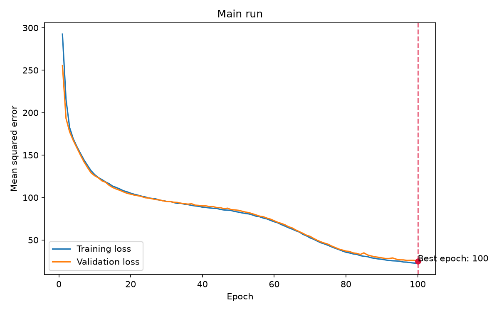

# Lakeshore Bike Demand

## What it does

This project predicts hourly bike rentals from the supplied synthetic station-hour data. It compares a training-mean baseline and a linear regression baseline with a hand-built PyTorch regression network.

## How to run it

Create and activate the conda environment, then regenerate the reports and run the checks:

```bash
conda env create -f environment.yml
conda activate lab07-first-principles
python train.py
python -m ruff format --check .
python -m ruff check .
python -m pytest
```

## Data and split

`bikes_data.py` generates 6,000 synthetic station-hour rows with seed `2026`. The rows are split once into 3,600 training, 1,200 validation, and 1,200 test examples. Numeric features are standardized and `station_type` is one-hot encoded using transformations fitted only on training rows; `is_weekend` is passed through. The rental count is kept separate from the features. The same fitted transformations are used for validation and test data.

The exploratory plot shows distinct morning and evening peaks around 8:00 and 17:00–18:00, so rentals do not follow a straight-line relationship with hour. This helps explain why the linear regression baseline trails the neural network. The plot is generated at [`reports/rentals_by_hour.png`](reports/rentals_by_hour.png).

## Model and training

`BikeRentalRegressor` is an `nn.Module` with two ReLU hidden layers and a single unrestricted scalar output. Training uses a handwritten loop, mean squared error, Adam, and batches of 64. Python, NumPy, PyTorch, and the training DataLoader use seed `2026`; validation and test loaders do not shuffle. Each epoch records training loss, validation loss, and validation MAE. The saved checkpoint is the epoch with the lowest validation loss. Hyperparameter selection uses validation MAE only.

## Results

MAE is reported in rentals. The final neural network was selected on validation data, retrained with the same settings, and restored to its best validation-loss checkpoint before the final test evaluation.

| Model | Validation MAE | Test MAE |
|---|---:|---:|
| Training mean | 9.952 | 9.848 |
| LinearRegression | 9.032 | 8.763 |
| Neural network, hidden sizes `(128, 64)` | **2.787** | **2.685** |

The linear model performs worse because a single straight-line relationship cannot represent the plotted rush-hour peaks and other feature interactions as well as the selected network. The main run’s training and validation losses continue to fall through epoch 100, with a small gap; the selected wider network has lower validation loss and no observed validation-loss rise within the run.



## Experiments

Each additional run changes one hyperparameter relative to the main run. “Best epoch” is the minimum-validation-loss checkpoint; best validation MAE is the lowest value observed across epochs.

| Run | Hyperparameters | Best epoch | Best validation MAE | Final training loss | Final validation loss | Observation |
|---|---|---:|---:|---:|---:|---|
| Main | hidden `(64, 32)`, lr `0.001`, batch `64`, 100 epochs | 100 | 3.375 | 22.629 | 24.735 | Losses track closely and continue downward through the last epoch. |
| Low learning rate | hidden `(64, 32)`, lr `0.0001`, batch `64`, 100 epochs | 100 | 7.623 | 125.300 | 125.388 | Similar train and validation losses remain high, consistent with slower learning at this rate. |
| Wider hidden layers | hidden `(128, 64)`, lr `0.001`, batch `64`, 100 epochs | 100 | **2.787** | 13.047 | 16.218 | Best validation MAE; validation loss is still decreasing, with a modest train/validation gap. |

The wider network is selected because it has the lowest validation MAE. All three runs reach their best validation-loss checkpoint at epoch 100, so these curves show no validation-loss reversal within the tested training duration. Curves for every run are saved in `reports/`; per-epoch main-run history is in `reports/history.csv`, and run settings and metrics are in `reports/experiments.csv`.

## Limitations

These are invented station-hour observations, not records from real riders or stations. The data cannot capture actual station capacity, bike availability, holidays, events, seasonal changes, or local operating conditions. The results should not be used as real-world demand forecasts or for operational decisions without validating against representative observed data.
